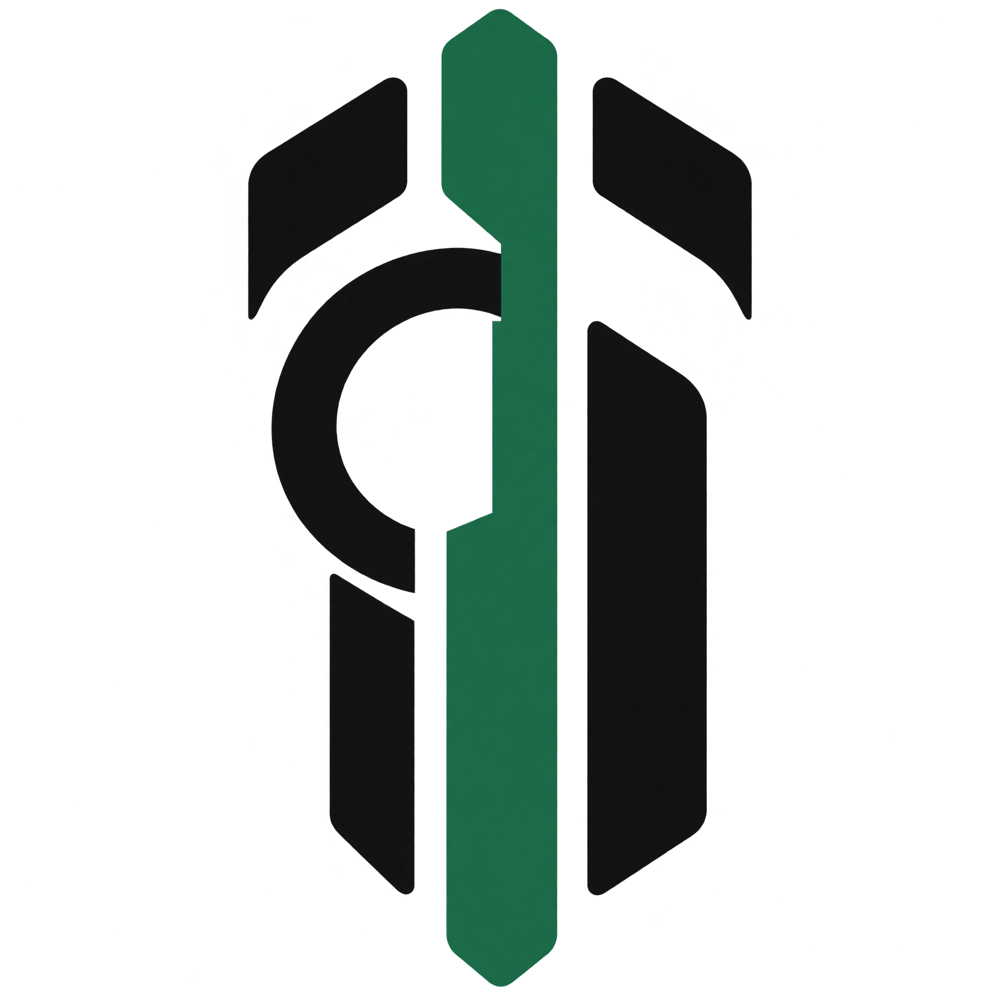
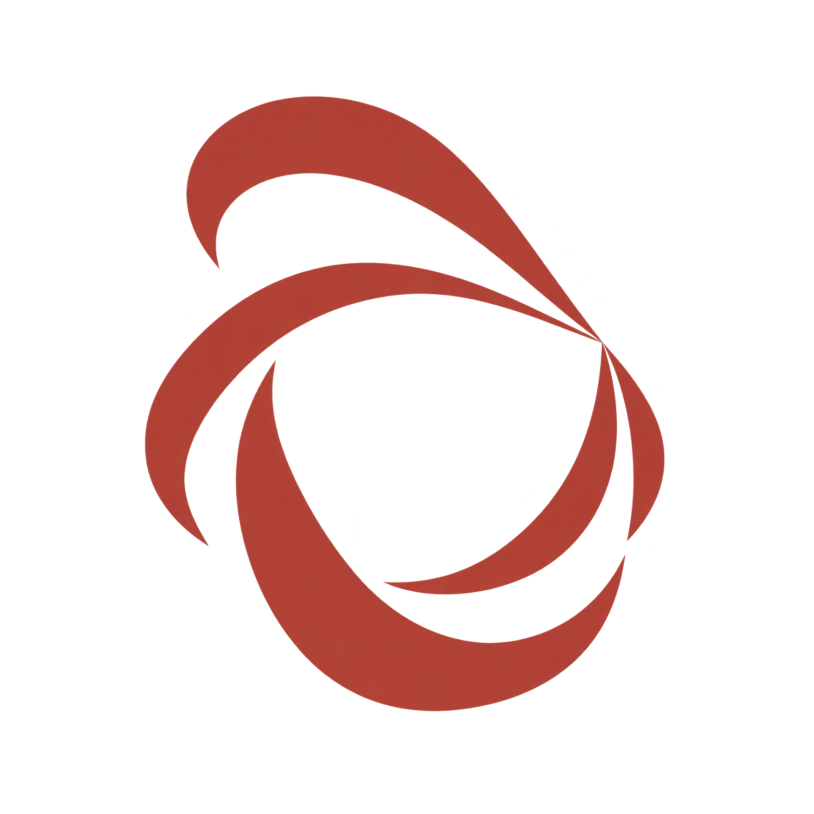
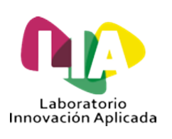

<!-- Texto animado como cabecera -->

  

<!-- Badges de estado -->

  
  
  

---

## 🚀 Sobre mí

- 💻 Desarrollador de software y fundador de **Cleridor**.
- 🌱 Siempre aprendiendo nuevas tecnologías, frameworks y buenas prácticas.
- 🎯 Me gusta construir proyectos que resuelvan problemas reales y que sean fáciles de usar.
- 🧠 Disfruto explorando áreas nuevas, desde el backend hasta el frontend y las apps móviles.
- 🤝 Abierto a colaborar en proyectos interesantes y a compartir conocimiento.

---

## 🏢 Mi Empresa

  
  <b>Cleridor</b> 
  Fundé Cleridor (aun nada legal) con el objetivo de crear soluciones de software de alta calidad. Nos enfocamos en desarrollar herramientas útiles, eficientes y con un diseño cuidado, alejándonos de lo genérico para ofrecer productos que realmente aporten valor.
   

---

## 📂 Proyectos

<table>
  <tr>
    <td align="center" width="150">
       
      <b>El Ojo del Crimen</b>
    </td>
    <td>
      <b>Proyecto Educativo (Finalizado)</b> 
      Una herramienta diseñada para demostrar visualmente cómo es posible extraer credenciales almacenadas en un sistema local. El desarrollo llegó a su fin de forma abrupta cuando Windows Defender eliminó el código fuente automáticamente tras catalogarlo erróneamente como un virus. (my bad)
    </td>
  </tr>
  <tr>
    <td align="center" width="150">
       
      <b>Proyecto Fenix</b>
    </td>
    <td>
      <b>Aplicación de Fitness (En Pausa)</b> 
      Plataforma revolucionaria enfocada en el entrenamiento 100% personalizado, alejándose de las aplicaciones genéricas del mercado. Permitía adaptar cada detalle del entrenamiento al usuario. Actualmente en pausa debido a problemas de conflictos con el dominio del proyecto. (my bad nuevamente)
    </td>
  </tr>
  <tr>
    <td align="center" width="150">
       
      <b>Belona</b> <em>(Secreto)</em>
    </td>
    <td>
      <b>Nuevo Proyecto (En Desarrollo)</b> 
      Mi proyecto más ambicioso hasta la fecha. Llevo varios meses trabajando en secreto en esta nueva plataforma, de la cual todavía no puedo revelar detalles. El lanzamiento está previsto para finales de enero o principios de febrero. ¡Espero que tenga una gran acogida!
    </td>
  </tr>
  <tr>
    <td align="center" width="150">
      <!-- Cambia "./lia.png" por el nombre real de tu imagen si la tienes -->
       
      <b>LIA</b>
    </td>
    <td>
      <b>Laboratorio de Innovación Aplicada (Instituto Santo Tomás - Finalizado)</b> 
      Participé en el desarrollo de un sistema de monitoreo ambiental orientado a medir la calidad del aire y los niveles de contaminación. El proyecto integraba la recolección de datos críticos como temperatura, radiación y otras métricas, aportando información valiosa para el análisis del entorno.
    </td>
  </tr>
</table>

---

## 🔨 Actualmente trabajando en...

- 👀 Desarrollando el proyecto secreto **Belona**, con lanzamiento previsto para principios de año.
- 🧪 Practicando con **Flask**, **Django** y **Vue** para ampliar mi stack.
- 📱 Explorando **Flutter** para el desarrollo de aplicaciones móviles multiplataforma.
- 🗄️ Profundizando en bases de datos como **MySQL**, **PostgreSQL** y **Supabase**.

---

## 🛠️ Tecnologías y herramientas

**Lenguajes**

  
  
  
  

**Frameworks y librerías**

  
  
  
  
  
  

**Bases de datos**

  
  
  
  
  

**Herramientas**

  
  
  

---

